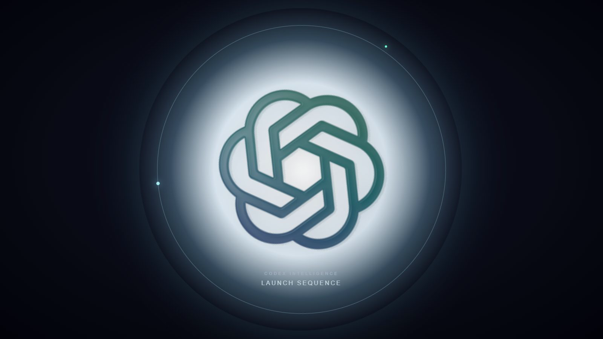
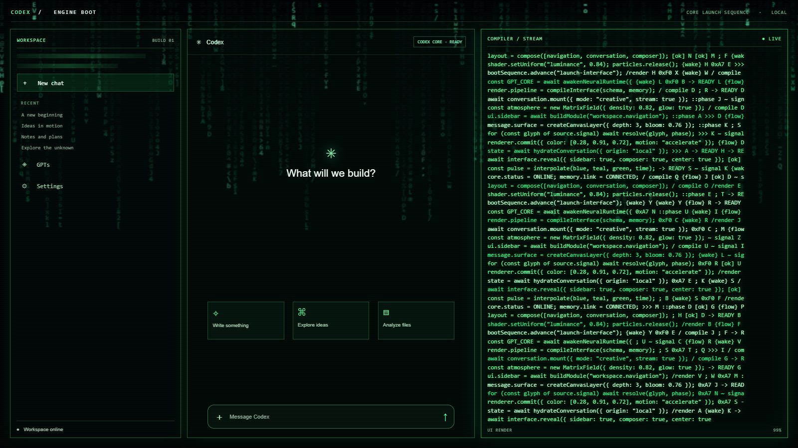

# Codex Startup Animation

> A cinematic, two-stage boot sequence for the Windows Codex desktop app.
> Unofficial community project. Not affiliated with or endorsed by OpenAI.


Double-click the **Codex 启动** shortcut and the launcher:

1. Draws a transparent vector wake sequence over the real desktop.
2. Starts the official Codex / ChatGPT client in the background.
3. Builds a full-screen green interface while generated code streams in.
4. Presents animated runtime cards, model routing and progress telemetry.
5. Ends with `SYSTEM READY TO LAUNCH` and a CRT-style handoff to the real app.

The launcher does not modify, patch, sign or repackage the official client.

## Preview

| Wake sequence | Interface compilation |
| --- | --- |
|  |  |

The repository also includes a browser preview:

```text
startup-animation-v2.html
```

Open it in a Chromium-based browser to inspect the motion without launching Codex.

## Install

### Option A: release ZIP

1. Download and fully extract the release ZIP.
2. Keep the extracted folder in a permanent location.
3. Run `install.ps1` once.
4. Use the **Codex 启动** shortcut on the desktop.

The installer copies the launcher to:

```text
%LOCALAPPDATA%\Programs\CodexStartupAnimation
```

If you move the folder manually, run the launcher or install script again so the
desktop shortcut points to the new location.

### Option B: existing prebuilt launcher

Run `ChatGPT-Boot.exe` once. The launcher discovers the installed Codex or
ChatGPT app, creates or refreshes the desktop shortcut, and starts the animation.

## Build from source

Requirements:

- Windows 10 or Windows 11
- .NET Framework 4.8
- Windows PowerShell 5.1 or PowerShell 7

Build with the Windows compiler included in .NET Framework:

```powershell
./build.ps1
```

Create the distributable ZIP as well:

```powershell
./build.ps1 -Zip
```

Output:

```text
dist/
  ChatGPT-Boot.exe
  ChatGPT-Green-GPT.ico
  logo-mark.path
  README.md
  DISCLAIMER.md
  LICENSE

Codex-Startup-Animation.zip
```

Install from the local source tree:

```powershell
./install.ps1
```

Install without immediately starting the animation:

```powershell
./install.ps1 -NoLaunch
```

Remove the desktop shortcut:

```powershell
./uninstall.ps1
```

## How it works

The app is a single native WPF executable with no Node.js, Electron, Python or
installer framework dependency.

- `Boot.cs` contains the animation renderer, client discovery, overlay placement,
  focus handoff and transition logic.
- `logo-mark.path` supplies the vector mark embedded into the executable.
- `Boot.manifest` enables Per-Monitor V2 DPI awareness.
- `startup-animation-v2.html` is a self-contained browser concept preview.
- `build.ps1` compiles the WPF source with the in-box .NET Framework compiler.
- `.github/workflows/build.yml` validates the source and uploads the Windows ZIP.

During startup, the animation checks the Windows Start applications list for a
Codex or ChatGPT app identifier. It then waits for the matching client window,
places the overlay over that display, and holds the final frame until the client
is ready. If the client already exists, the existing window is reused.

## Controls and recovery

- Press `Esc` or click the animation to skip it.
- A second launch does not stack duplicate overlays.
- The animation automatically times out rather than leaving an unusable full-screen overlay.
- If no supported client is found, an explanatory message is shown.
- Move the whole release folder after installation and run `install.ps1` again
  if the shortcut target is no longer valid.

## Project structure

```text
.
├─ .github/workflows/build.yml
├─ Boot.cs
├─ Boot.manifest
├─ build.ps1
├─ install.ps1
├─ uninstall.ps1
├─ startup-animation-v2.html
├─ logo-mark.path
├─ ChatGPT-Green-GPT.ico
├─ ChatGPT-Boot.exe
├─ CHANGELOG.md
├─ DISCLAIMER.md
└─ LICENSE
```

Additional design notes from the v3 visual iteration are preserved in
[`docs/DESIGN_NOTES.md`](docs/DESIGN_NOTES.md).

## Compatibility

Tested with the Windows Codex desktop package:

```text
OpenAI.Codex
```

The launcher also recognizes visible windows from processes named `ChatGPT` and
`Codex`. Other desktop distributions should work if they expose a standard
Windows application identifier or one of those process names.

## Licensing and attribution

The source is released under the [MIT License](LICENSE).

This repository is an unofficial artistic project created by Artemis / Tom.
OpenAI, ChatGPT, Codex and related marks belong to their respective owners.
Read the full [brand and usage disclaimer](DISCLAIMER.md).

Animation visuals and demo artwork are included for personal learning,
research and artistic use. The generated code and status cards are simulated
and do not represent real model access, permissions or service state.
