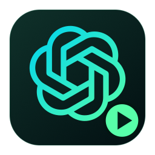
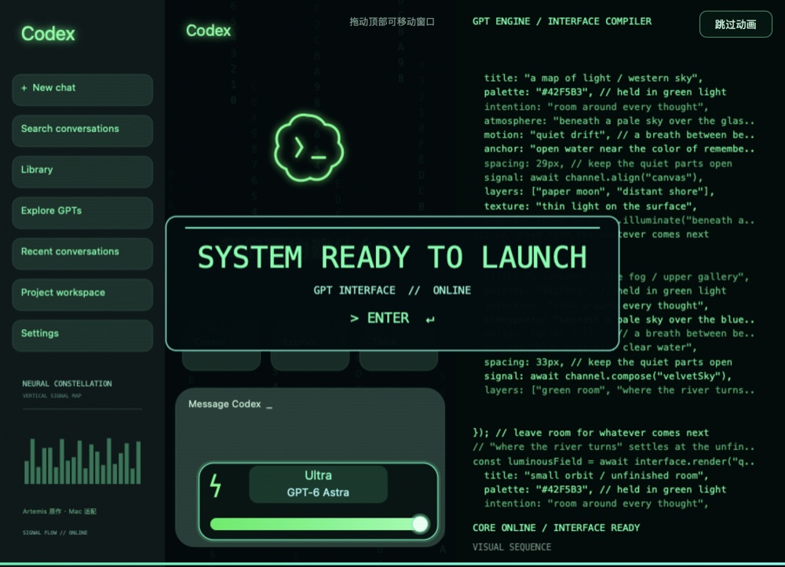

# macOS 启动器（Apple Silicon）

用 AppKit 和 WebKit 实现的独立 macOS 启动器：打开或复用已安装的 Codex，在其窗口内播放动画，完成后退出。画面覆盖标题栏和四周，鼠标仍可通过顶部中间区域拖动原窗口，通过边缘缩放。

没有登录启动项或常驻助手，不修改官方客户端。只有从这个启动器打开时才播放；原 Codex 图标保持原有行为。客户端按 `com.openai.codex` 识别，不依赖 `.app` 文件名。



## 构建与打开

需要 Apple Silicon Mac、Xcode 命令行工具和 Python 3。部署目标为 macOS 13；旧系统和 Intel Mac 尚未验证。

在仓库根目录执行：

```sh
cd macos
/bin/zsh build.sh
```

生成 `dist/Codex 启动器.app`。在访达中双击它，或将其拖到“应用程序”后使用。动画约 15 秒，提前结束可点右上角“跳过动画”。

成功标志：动画覆盖 Codex 的整个窗口，结束后原界面可继续操作，启动器退出。找不到客户端或可见窗口时会结束，不会改为覆盖整个屏幕。

想固定到底部图标栏，手动把启动器拖到 Dock 的应用区域。启动器与真实客户端是两个应用，运行时可能分别显示图标。

## 可选的后台安装

先构建，再执行：

```sh
/usr/bin/python3 install.py
```

默认安装到 `/Applications/Codex 启动器.app`。安装器校验标识和签名，暂存后原子替换；遇到其他应用、运行中的启动器或无写入权限时停止。它不会启动应用、修改 Dock 或创建登录项。

移除时，在“应用程序”中删除启动器，并手动移除已固定的 Dock 图标即可。

## 验证

自动检查另外需要 Node.js。

```sh
/bin/zsh Tests/run-tests.sh
```

检查包含启动阶段和参数、窗口及输入区域、指针坐标计算、12 个 Canvas 关键帧、页面及原生控件离屏图、透明像素、失败退出码和应用签名。不打开可见窗口，不启动或重启真实 Codex。没有安装客户端也能运行这些检查。

结果在 `test-results/`，渲染图在 `previews/`。这些生成目录不提交版本库。更多边界见 [TESTING.md](TESTING.md)。

## 交互与实现

- 画面完整铺在目标窗口上；透明输入保护区域挡住看不见的内容、关闭及导航按钮，顶部中间和窗口边缘交给原客户端处理。
- 播放期间临时观察鼠标按下、拖动、松开事件，不改变事件、不观察键盘、不保存坐标，结束后移除。
- 拖动时直接按指针位移移动动画，纯移动不重设 WebView/Canvas 尺寸。非拖动时在后台校准窗口位置，避免在拖动回调里枚举窗口。
- 其他应用切到前台时隐藏动画，结束时不抢回焦点；窗口不可见时退出。
- 单次播放有互斥锁和超时，重复打开不叠加。提前结束统一使用原生“跳过动画”按钮。
- 所有页面资源在本地，不联网；动画中的代码、模型名称和进度是装饰演示。

动画预览（由离屏检查生成）：



## 开发参数

```sh
"dist/Codex 启动器.app/Contents/MacOS/CodexStartupMac" --diagnostics
"dist/Codex 启动器.app/Contents/MacOS/CodexStartupMac" --self-test
```

`--preview` 仅播放并复用已有客户端；`--duration 2...60` 调整总时长；`--client-bundle-id ID` 选择测试客户端。播放类参数会显示窗口，使用前自行安排前台操作时段。

## 授权和来源

复用根目录 Windows 实现的场景结构、时序及 `logo-mark.path` 矢量路径，以 Canvas 重写绘制，以 AppKit 重写窗口交接。保留原作者 MIT 许可及 [非官方品牌说明](UPSTREAM-NOTICE.md)。Mac 字体、装饰代码和小尺寸布局存在差异，不声称逐像素复刻，也不包含 Green Room 主题。

本地构建采用临时签名，未做 Developer ID 签名或 Apple 公证。此目录提供源码，不提交 `.app`、安装记录或设备日志。
